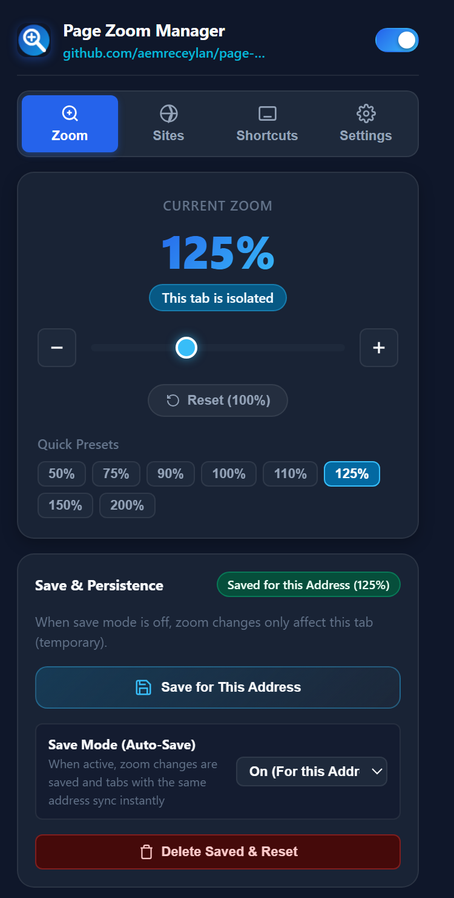
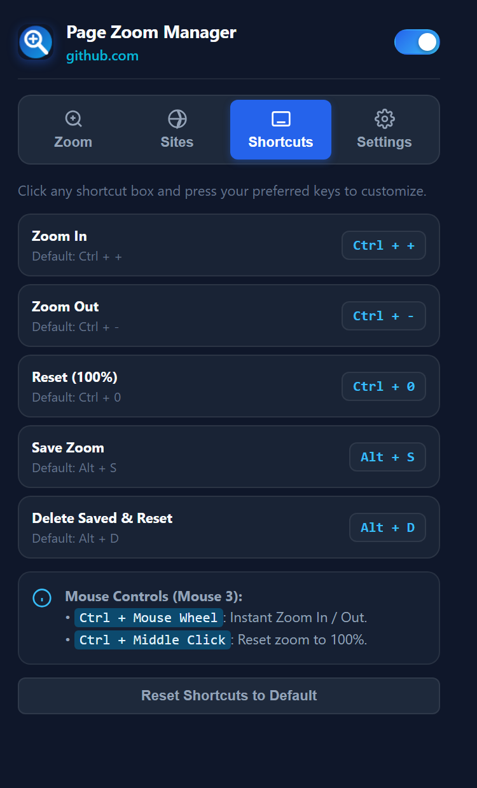
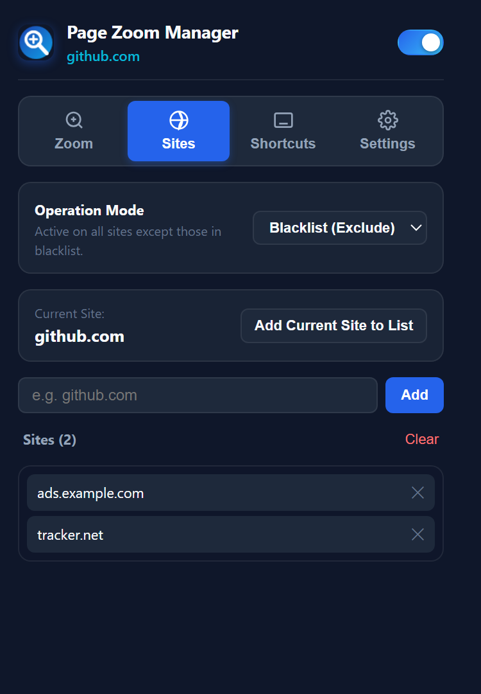
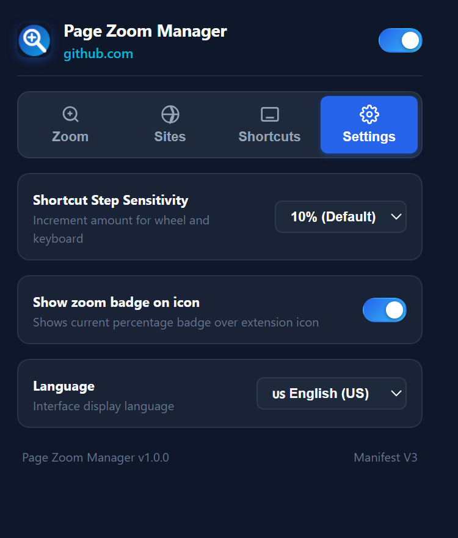

# Page Zoom Manager — Chrome Extension (Manifest V3)

[](https://developer.chrome.com/docs/extensions/mv3/intro/)
[](LICENSE)
[](#-internationalization-i18n)

A powerful, privacy-first Chrome extension that solves the browser's default behavior of synchronizing zoom levels across all tabs of the same website. Enjoy **true per-tab zoom isolation**, clean-URL persistence, customizable keyboard and mouse shortcuts, and flexible domain rules.

---

## 📸 Interface Tour & Visual Walkthrough

<div align="center">

<table style="width: 100%; max-width: 900px; border-collapse: collapse;">
  <tr>
    <td width="50%" valign="top" align="left" style="padding: 16px;">
      <h3 align="center">🔍 Zoom & Persistence Engine</h3>
      <p align="center">
        
      </p>
      <b>Key UI Capabilities:</b>
      <ul>
        <li><b>Per-Tab Isolation:</b> Live status pill confirming current tab's zoom is fully decoupled.</li>
        <li><b>Precision Controls:</b> Stepper buttons, real-time drag slider, and quick presets (50%–200%).</li>
        <li><b>Clean-URL Persistence:</b> Saves zoom per address path without query/hash clutter.</li>
        <li><b>Live Record Mode:</b> Toggle auto-save for current address with real-time cross-tab sync.</li>
      </ul>
    </td>
    <td width="50%" valign="top" align="left" style="padding: 16px;">
      <h3 align="center">⌨️ Custom Shortcuts & Mouse 3</h3>
      <p align="center">
        
      </p>
      <b>Key UI Capabilities:</b>
      <ul>
        <li><b>Interactive Key Recorder:</b> Click any field and type keys to reassign shortcuts on the fly.</li>
        <li><b>Mouse 3 Overrides:</b> <code>Ctrl + Wheel</code> stepping and <code>Ctrl + Middle Click</code> 100% reset.</li>
        <li><b>Action Shortcuts:</b> One-touch save (<code>Alt + S</code>) & reset (<code>Alt + D</code>) with in-page toast notices.</li>
        <li><b>Factory Reset:</b> Instantly revert all custom keybindings to defaults.</li>
      </ul>
    </td>
  </tr>
  <tr>
    <td width="50%" valign="top" align="left" style="padding: 16px;">
      <h3 align="center">🛡️ Site Rules & Domain Filters</h3>
      <p align="center">
        
      </p>
      <b>Key UI Capabilities:</b>
      <ul>
        <li><b>Blacklist vs. Whitelist:</b> Run everywhere except exclusions, or only on allowed domains.</li>
        <li><b>1-Click Site Toggle:</b> Quickly add or remove the current site directly from the active tab.</li>
        <li><b>Manual Domain Input:</b> Add domains manually (e.g. <code>github.com</code>) without opening them.</li>
        <li><b>List Management:</b> Clear all entries or remove individual domains effortlessly.</li>
      </ul>
    </td>
    <td width="50%" valign="top" align="left" style="padding: 16px;">
      <h3 align="center">⚙️ Preferences & Localization</h3>
      <p align="center">
        
      </p>
      <b>Key UI Capabilities:</b>
      <ul>
        <li><b>Step Sensitivity:</b> Choose wheel and shortcut increment granularity (5%, 10%, 15%, 20%, 25%).</li>
        <li><b>Live Badge:</b> Toggle the active tab's real-time zoom percentage over the toolbar icon.</li>
        <li><b>7 Native Languages:</b> English, Turkish, German, Spanish, French, Russian, and Japanese.</li>
        <li><b>Offline Architecture:</b> Strictly local settings with zero network tracking.</li>
      </ul>
    </td>
  </tr>
</table>

</div>

---

## 🚀 Key Features

### 1. 🔍 Per-Tab Zoom Isolation (Default: Stateless)
* **No Cross-Tab Bleed:** Zooming in one tab will **never** alter zoom levels in other tabs open to the same website or domain.
* **Temporary by Default:** Zoom levels are isolated to the active tab and reset automatically when the tab is closed, unless explicitly saved.

### 2. 💾 Smart Persistence & Auto-Save Recording
* **Clean-URL Matching:** Strips dynamic query parameters (`?query=...`) and hash fragments (`#hash`) to save zoom levels cleanly per address path.
* **Flexible Persistence Modes:**
  * **Save for this Address:** One-click save button and shortcut to remember your magnification preference for that specific page.
  * **Auto-Save / Record Mode:**
    * *Off (Temporary):* Per-tab ephemeral zoom.
    * *On (This Address):* Automatically saves any zoom adjustments for the current URL and synchronizes open tabs on that address in real time.
    * *Always On (All Addresses):* Automatically remembers zoom levels everywhere you browse.
* **One-Click Reset & Deletion:** Instantly wipe saved preferences for the current page and return to 100%.

### 3. 🖱️ Mouse & Keyboard Controls
* **`Ctrl + Mouse Wheel`:** Smooth, responsive zoom in and out directly on any web page.
* **`Ctrl + Middle Click (Mouse 3)`:** Instantly reset page zoom to 100%.
* **`Ctrl + +` / `Ctrl + -`:** Standard keyboard override for zoom in and out.
* **`Ctrl + 0`:** Instant 100% reset.
* **`Alt + S`:** Quick shortcut to save the active zoom level for the current address.
* **`Alt + D`:** Quick shortcut to delete the saved zoom level and reset.
* **Non-Intrusive In-Page Toasts:** Provides subtle, modern floating feedback when shortcuts are triggered.

### 4. ⌨️ Interactive Key Recorder
* Easily customize any shortcut directly from the **Shortcuts** tab in the popup.
* Click any shortcut box, press your preferred key combination, and it automatically registers.
* Includes a one-click **"Reset Shortcuts to Default"** option.

### 5. 🛡️ Site Management (Blacklist & Whitelist Modes)
* **Blacklist Mode:** The extension runs everywhere *except* domains in your blacklist.
* **Whitelist Mode:** The extension runs *only* on explicitly allowed domains.
* **Quick Toggle:** Add or remove the active site with a single click, or type domain names manually (e.g. `github.com`).

### 6. 🏷️ Real-Time Toolbar Badge
* Displays the active tab's current zoom percentage (`100%`, `125%`, `90%`) directly over the extension icon in Chrome's toolbar.
* Can be toggled on or off in the Settings tab.

### 7. 🌍 Internationalization (i18n — 7 Languages)
* Fully translated into **7 languages**:
  * 🇺🇸 English (US)
  * 🇹🇷 Türkçe (TR)
  * 🇩🇪 Deutsch (DE)
  * 🇪🇸 Español (ES)
  * 🇫🇷 Français (FR)
  * 🇷🇺 Русский (RU)
  * 🇯🇵 日本語 (JA)
* Automatically detects your browser's language on initial launch.
* Switch languages at any time from the Settings tab without reloading.

---

## ⌨️ Default Shortcuts Cheatsheet

| Action | Shortcut / Trigger | Description |
| :--- | :--- | :--- |
| **Zoom In** | `Ctrl + +` | Increases zoom by configured step size (default: 10%) |
| **Zoom Out** | `Ctrl + -` | Decreases zoom by configured step size |
| **Reset Zoom** | `Ctrl + 0` | Resets zoom level to 100% |
| **Mouse Wheel Zoom** | `Ctrl + Wheel Up / Down` | Instant wheel-based magnification |
| **Middle Click Reset** | `Ctrl + Mouse 3 (Wheel Click)` | Resets current tab zoom to 100% |
| **Save Zoom** | `Alt + S` | Persists current zoom level for this address |
| **Delete Saved Zoom** | `Alt + D` | Deletes saved zoom rule and resets tab to 100% |

> *All keyboard shortcuts can be customized in the extension popup.*

---

## 🛠️ Installation Guide (Load Unpacked)

To install and run the extension locally in Google Chrome:

1. Clone or download this repository to your local machine:
   ```bash
   git clone https://github.com/aemreceylan/page-zoom-extension.git
   ```
2. Open Google Chrome and navigate to:
   ```text
   chrome://extensions
   ```
3. Enable **Developer mode** using the toggle in the top-right corner.
4. Click the **Load unpacked** button in the top-left corner.
5. Select the `page-zoom-extension` directory.
6. The extension is now installed! Pin it to your toolbar for easy access.

---

## 📁 Project Structure

```text
page-zoom-extension/
├── manifest.json              # Manifest V3 configuration, permissions, and service worker registration
├── background/
│   └── service-worker.js      # Per-tab isolation engine, cross-tab sync, badge controller & storage
├── content/
│   ├── content.js             # In-page event interceptor (Ctrl+Wheel, Mouse 3, key combos & toast notifications)
│   └── content.css            # Styles for sleek floating in-page feedback toasts
├── popup/
│   ├── popup.html             # 4-tab modern popup interface (Zoom, Sites, Shortcuts, Settings)
│   ├── popup.css              # Dark theme glassmorphism styling
│   └── popup.js               # Popup controller, interactive key recorder & dynamic i18n
├── locales/
│   └── translations.js        # Modular dictionary system for 7 languages & browser locale detection
├── icons/                     # Vector-derived high-resolution icons (16px, 48px, 128px)
├── screenshots/               # Real UI screenshots captured from Chrome
│   ├── popup-zoom.png         # Zoom & persistence tab preview
│   ├── popup-shortcuts.png    # Shortcuts & key recorder tab preview
│   ├── popup-sites.png        # Sites management tab preview
│   └── popup-settings.png     # Preferences & localization tab preview
├── CHROMEWEBSTORE.md          # Chrome Web Store submission copy & reviewer justification
└── README.md                  # Project documentation and guide
```

---

## 🔒 Permissions & Privacy

Page Zoom Manager is strictly private and offline-first:

* **`tabs`**: Used to identify the active tab's URL and apply tab-isolated zoom settings via the Chrome Zoom API.
* **`storage`**: Used to save user preferences locally (custom shortcuts, step size, domain rules, saved zoom ratios).
* **`host_permissions` (`<all_urls>`)**: Required to inject content listeners so that `Ctrl + Wheel`, `Ctrl + Mouse 3`, and custom keybindings function smoothly on web pages.
* **Zero Data Collection**: No telemetry, analytics, or external server calls. All logic and storage remain 100% local on your device.

---

## 🤝 Contributing

Contributions, bug reports, and suggestions are welcome!

1. Fork the repository.
2. Create your feature branch (`git checkout -b feature/amazing-feature`).
3. Commit your changes (`git commit -m 'feat: add amazing feature'`).
4. Push to the branch (`git push origin feature/amazing-feature`).
5. Open a Pull Request.

---

## 📄 License

This project is licensed under the MIT License — see the [LICENSE](LICENSE) file for details.
